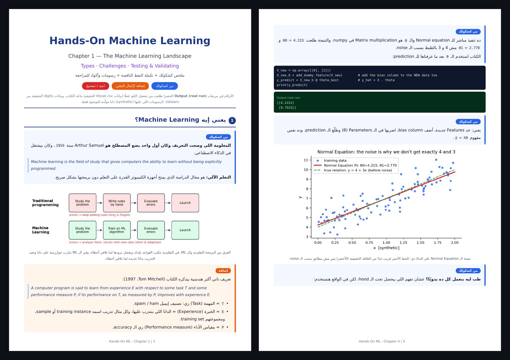

<div align="center">
  
</div>

<p align="center">
  
  
  
  
  
</p>

<div dir="rtl">

## 📖 عن المشروع

شرحي الشخصي لكتاب **Hands-On Machine Learning with Scikit-Learn, Keras & TensorFlow** (الطبعة الثالثة)، مكتوب بالعربي مع المصطلحات الإنجليزية، ومنظم فصل بفصل مع المعادلات والرسومات وأسئلة المراجعة. اتكتب أثناء التعلم واتراجع على الكتاب، عشان يساعد أي حد يذاكر بسرعة.

</div>

## 📖 About

Personal study notes for **Hands-On Machine Learning with Scikit-Learn, Keras & TensorFlow (3rd Edition)** by Aurélien Géron. Notes are written in Arabic with English technical terms, organized chapter by chapter, with equations, diagrams and review questions. They are meant for revision, not as a replacement for the book.

---

## 👀 Preview

<div align="center">
  
  <br/>
  <sub>Left: Chapter 1 first page. Right: Chapter 4, code + real output + plot. Arabic explanation with English terms.</sub>
</div>

Each chapter PDF mixes **my handwritten notes**, **completed missing points**, **diagrams**, **runnable code with real outputs**, and **review questions**.

---

## 📚 Chapters

| # | Chapter | Pages | Notes |
|---|---|---|---|
| 1 | The Machine Learning Landscape | 24 | [📄 PDF](notes/Chapter%201%20ML.pdf?raw=true) |
| 2 | End-to-End Machine Learning Project | 36 | [📄 PDF](notes/Chapter%202%20ML.pdf?raw=true) |
| 3 | Classification | 23 | [📄 PDF](notes/Chapter%203%20ML.pdf?raw=true) |
| 4 | Training Models | 35 | [📄 PDF](notes/Chapter%204%20ML.pdf?raw=true) |
| 5 | Support Vector Machines | — | ⏳ Soon |
| 6 | Decision Trees | — | ⏳ Soon |
| 7 | Ensemble Learning and Random Forests | — | ⏳ Soon |
| 8 | Dimensionality Reduction | — | ⏳ Soon |
| 9 | Unsupervised Learning Techniques | — | ⏳ Soon |
| 10 | Introduction to Artificial Neural Networks with Keras | — | ⏳ Soon |
| 11 | Training Deep Neural Networks | — | ⏳ Soon |
| 12 | Custom Models and Training with TensorFlow | — | ⏳ Soon |
| 13 | Loading and Preprocessing Data with TensorFlow | — | ⏳ Soon |
| 14 | Deep Computer Vision Using Convolutional Neural Networks | — | ⏳ Soon |
| 15 | Processing Sequences Using RNNs and CNNs | — | ⏳ Soon |
| 16 | Natural Language Processing with RNNs and Attention | — | ⏳ Soon |
| 17 | Autoencoders, GANs, and Diffusion Models | — | ⏳ Soon |
| 18 | Reinforcement Learning | — | ⏳ Soon |
| 19 | Training and Deploying TensorFlow Models at Scale | — | ⏳ Soon |

> When a new chapter is added, change `⏳ Soon` to a PDF link and update the **Chapters** and **Pages** badges at the top.

---

## 🗂️ Repository Structure

```
hands-on-ml-notes/
├── README.md
├── LICENSE
├── .gitignore
├── assets/
│   ├── header.svg
│   └── preview.png
└── notes/                # final PDFs, one per chapter
    ├── Chapter 1 ML.pdf
    ├── Chapter 2 ML.pdf
    ├── Chapter 3 ML.pdf
    └── Chapter 4 ML.pdf
```

## 🧭 How to Use

1. Read the chapter in the book first, then open the matching PDF to revise.
2. Use the review questions at the end of each PDF to test yourself.
3. Found a mistake or something unclear? Open an **Issue** and I will fix it.

## ⚠️ Disclaimer

These are personal study notes. All credit for the book and its original content goes to **Aurélien Géron** and **O'Reilly Media**. This repository does **not** contain the book. Please buy or borrow the book to support the author.

## 📜 License

My own writing, explanations, diagrams and code in this repository are licensed under the [MIT License](LICENSE): you may share and adapt them as long as you keep the copyright notice and give credit. This license covers **only my original contribution**. Content, text and figures that come from the book remain the property of their respective owners and are not covered by this license.

---

## 🤝 Author

<div align="center">
  <a href="https://github.com/mostafashazly7"></a>
  <a href="https://www.linkedin.com/in/mostafa-shazly-148945314/"></a>
</div>

<div align="center">
  <sub>If these notes helped you, a ⭐ on the repo means a lot.</sub>
</div>
